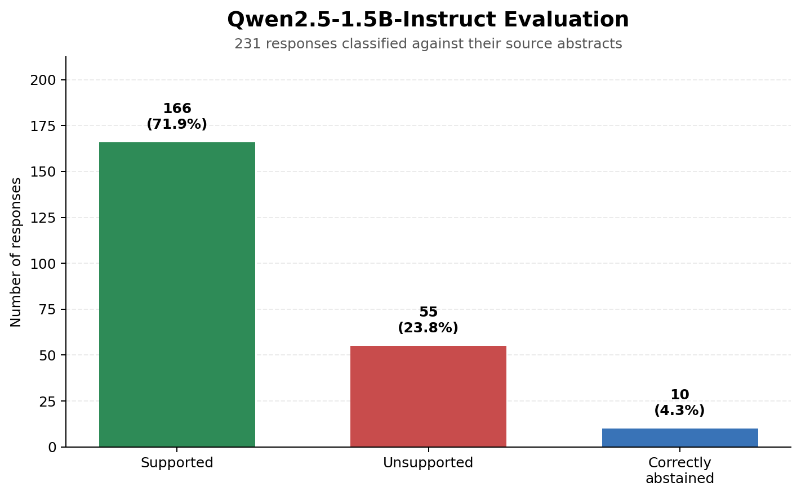
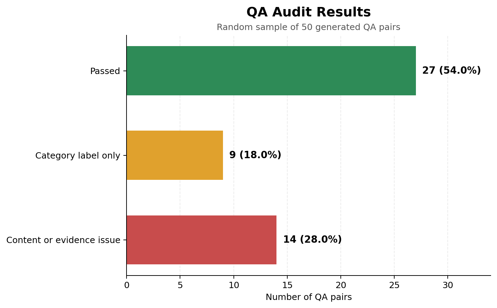

# Materials Science QA Evaluation

This project builds and evaluates a question-answering dataset from recent materials-science abstracts.

## Steps

1. Collected 1,500 recent abstracts from `cond-mat.mtrl-sci` using the arXiv API.
2. Removed duplicate records.
3. Filtered papers for materials-science relevance using Llama 3.2 through Ollama.
4. Generated QA pairs with Mistral Small.
5. Defined error categories and reviewed a random sample of 50 pairs.
6. Corrected the audited errors and removed unsuitable pairs, producing 231 final pairs.
7. Evaluated Qwen2.5-1.5B-Instruct by giving it each abstract and question.
8. Reviewed each Qwen response as `supported`, `unsupported`, or `correctly_abstained`.

## Main files

- `WRITEUP.md`: combined orientation, results, and critique
- `data/final/qa_dataset.jsonl`: final QA dataset
- `data/processed/qa_audit_reviewed.jsonl`: reviewed audit sample
- `data/evaluation/qwen_results.jsonl`: raw Qwen responses
- `data/evaluation/qwen_results_classified.jsonl`: classified Qwen responses
- `data/evaluation/qwen_evaluation_summary.md`: evaluation summary
- `docs/error_categories.md`: audit error definitions
- `docs/qa_audit_report.md`: audit results and data card
- `notebooks/qwen_evaluation.ipynb`: Colab evaluation code

## Results

### Qwen evaluation



### QA audit



## Running the pipeline

Install the packages:

```bash
pip install -r requirements.txt
```

Run the main scripts in order:

```bash
python src/fetch_arxiv.py
python src/filter_abstracts.py
python src/filter_materials.py
python src/generate_qa.py
python src/random_picker.py
```

The Qwen evaluation notebook was run on a free Google Colab T4 GPU. Manual audit and evaluation labels are stored directly in the reviewed JSONL files.

Only the random sample of 50 QA pairs was manually audited. The remaining 190 final pairs were not part of that audit, so the final dataset error rate is unknown.
